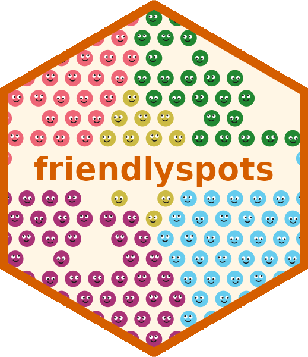
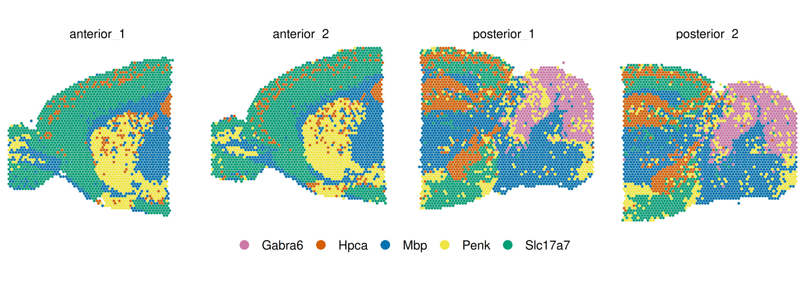
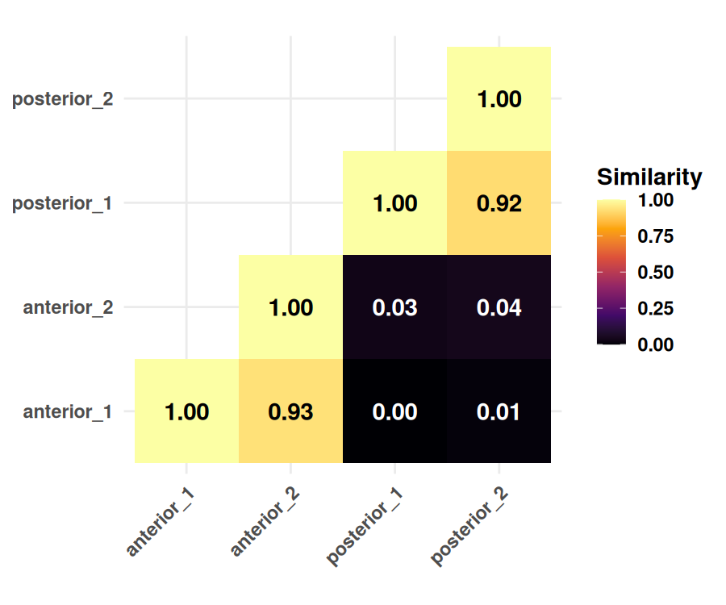

<!-- README.md is generated from README.Rmd with knitr::knit("README.Rmd"). Please edit that file -->


# friendlyspots 

Compute similarity between spatial transcriptomics samples based on which
labels (e.g. cell types) border one another.

## Installation

```r
remotes::install_github("george-hall-ucl/friendlyspots", subdir = "R")
```

Requires only base R. Also available as a
[Python package](https://github.com/george-hall-ucl/friendlyspots/tree/main/python).

## Usage

`friendlyspots` is only compatible with original (non-HD) Visium.

```r
library(friendlyspots)

# Create one data frame per sample, with columns for array_row, array_col,
# label.
#   e.g. starting from a sample's Seurat object `cells` (requires a VisiumV1
#   image, the default before Seurat 5.1):
#   coords <- cells@images[[1]]@coordinates
#   df1 <- data.frame(array_row = coords$row, array_col = coords$col,
#                     label = cells$cell_type[rownames(coords)])
samples <- list(sample_1 = df1, sample_2 = df2, sample_3 = df3)

sim <- spatial_similarity(samples)
```

Returns a sample × sample matrix with normalised similarity scores: 1 =
identical, 0 = least similar pair.

### Options

- `normalize = FALSE`: compare raw connection counts instead of proportions.
  This will make samples with different numbers of spots be considered
  spatially different even if their underlying spatial features are similar.
- `pools = list(group_1 = c("sample_1", "sample_2"), group_2 = "sample_3")`:
  sum connection counts within groups before comparing.

### Example

Uses four mouse brain sections from 10x Genomics (two anterior, two posterior),
with each spot labelled by its most enriched of five marker genes.

<details><summary>Setup: download and label the data, define plotting helpers (click to expand)</summary>


``` r
# To rebuild this README from README.Rmd, run knitr::knit("README.Rmd")
# from the R/ directory (rmarkdown::render breaks the <details> block).
# Requires `Seurat`, `hdf5r` and `ggplot2`.
library(Seurat)
library(ggplot2)

markers <- c("Mbp", "Slc17a7", "Penk", "Hpca", "Gabra6")
ids <- c(anterior_1 = "V1_Mouse_Brain_Sagittal_Anterior",
         anterior_2 = "V1_Mouse_Brain_Sagittal_Anterior_Section_2",
         posterior_1 = "V1_Mouse_Brain_Sagittal_Posterior",
         posterior_2 = "V1_Mouse_Brain_Sagittal_Posterior_Section_2")
cache <- tools::R_user_dir("friendlyspots", "cache")

seurat_objects <- lapply(ids, function(id) {
  dir <- file.path(cache, id)
  if (!dir.exists(file.path(dir, "spatial"))) {
    url <- paste0("https://cf.10xgenomics.com/samples/spatial-exp/1.1.0/",
                  id, "/", id)
    dir.create(dir, recursive = TRUE, showWarnings = FALSE)
    download.file(paste0(url, "_filtered_feature_bc_matrix.h5"),
                  file.path(dir, "filtered_feature_bc_matrix.h5"))
    download.file(paste0(url, "_spatial.tar.gz"), tar <- tempfile())
    untar(tar, exdir = dir)
  }
  image <- Read10X_Image(file.path(dir, "spatial"), image.type = "VisiumV1")
  Load10X_Spatial(dir, image = image)
})

labels <- lapply(seurat_objects, function(cells) {
  coords <- cells@images[[1]]@coordinates
  counts <- GetAssayData(cells, layer = "counts")[markers, rownames(coords)]
  counts <- as.matrix(counts)
  markers[max.col(t(counts / rowMeans(counts)), ties.method = "first")]
})

plot_slices <- function(samples) {
  spots <- do.call(rbind, Map(cbind, sample = names(samples), samples))
  ggplot(spots, aes(.data$array_col, -.data$array_row, color = .data$label)) +
    geom_point(size = 1.1, stroke = 0) +
    facet_wrap(~sample, nrow = 1) +
    coord_fixed(sqrt(3)) +
    scale_color_manual(values = c("#CC79A7", "#D55E00", "#0072B2", "#F0E442",
                                  "#009E73")) +
    guides(color = guide_legend(override.aes = list(size = 4))) +
    theme_void(base_size = 14) +
    theme(legend.position = "bottom", legend.title = element_blank())
}

plot_similarity <- function(sim) {
  df <- as.data.frame(as.table(sim))
  lower <- df[as.integer(df$Var1) >= as.integer(df$Var2), ]
  ggplot(lower, aes(.data$Var1, .data$Var2, fill = .data$Freq)) +
    geom_tile() +
    geom_text(aes(label = sprintf("%.2f", .data$Freq),
                  color = .data$Freq < 0.1),
              size = 5, fontface = "bold", show.legend = FALSE) +
    scale_color_manual(values = c("black", "white")) +
    scale_fill_viridis_c(option = "inferno", name = "Similarity") +
    coord_fixed() +
    theme_minimal(base_size = 14) +
    theme(axis.title = element_blank(),
          axis.text.x = element_text(angle = 45, hjust = 1),
          text = element_text(face = "bold"))
}
```

</details>

Each sample is a data frame of spot array coordinates and labels:


``` r
library(friendlyspots)

samples <- Map(function(cells, label) {
  coords <- cells@images[[1]]@coordinates
  data.frame(array_row = coords$row, array_col = coords$col, label = label,
             row.names = rownames(coords))
}, seurat_objects, labels)
head(samples$anterior_1)
#>                    array_row array_col   label
#> AAACAAGTATCTCCCA-1        50       102     Mbp
#> AAACACCAATAACTGC-1        59        19 Slc17a7
#> AAACAGAGCGACTCCT-1        14        94 Slc17a7
#> AAACAGCTTTCAGAAG-1        43         9     Mbp
#> AAACAGGGTCTATATT-1        47        13    Penk
#> AAACATGGTGAGAGGA-1        62         0 Slc17a7
```


``` r
plot_slices(samples)
```




``` r
sim <- spatial_similarity(samples)
round(sim, 2)
#>             anterior_1 anterior_2 posterior_1 posterior_2
#> anterior_1        1.00       0.93        0.00        0.01
#> anterior_2        0.93       1.00        0.03        0.04
#> posterior_1       0.00       0.03        1.00        0.92
#> posterior_2       0.01       0.04        0.92        1.00
plot_similarity(sim)
```



## Citation

The algorithm and original implementation of `friendlyspots` are based on the
methodology in:

- Durkin _et al_. "Functional integration of an autologous engineered esophagus
  in a large-animal model." _Nature Biotechnology_ (2026).
- Budinger _et al_. "An in vivo and in vitro spatiotemporal profile of human
  midbrain development." _Nature Communications_ (2026).

## Licence

Copyright (C) 2026 University College London. Licensed under GPL-3.0-or-later.

This program is free software: you can redistribute it and/or modify it under
the terms of the GNU General Public License as published by the Free Software
Foundation, either version 3 of the License, or (at your option) any later
version.

This program is distributed in the hope that it will be useful, but WITHOUT ANY
WARRANTY; without even the implied warranty of MERCHANTABILITY or FITNESS FOR A
PARTICULAR PURPOSE. See the GNU General Public License for more details.

You should have received a copy of the GNU General Public License along with
this program. If not, see http://www.gnu.org/licenses/.
