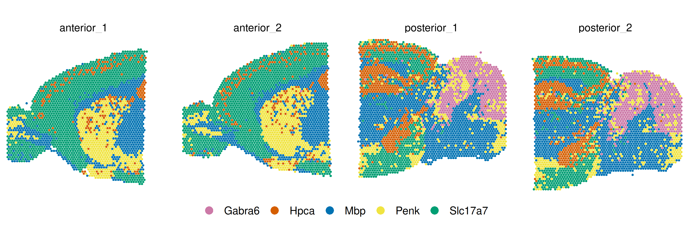
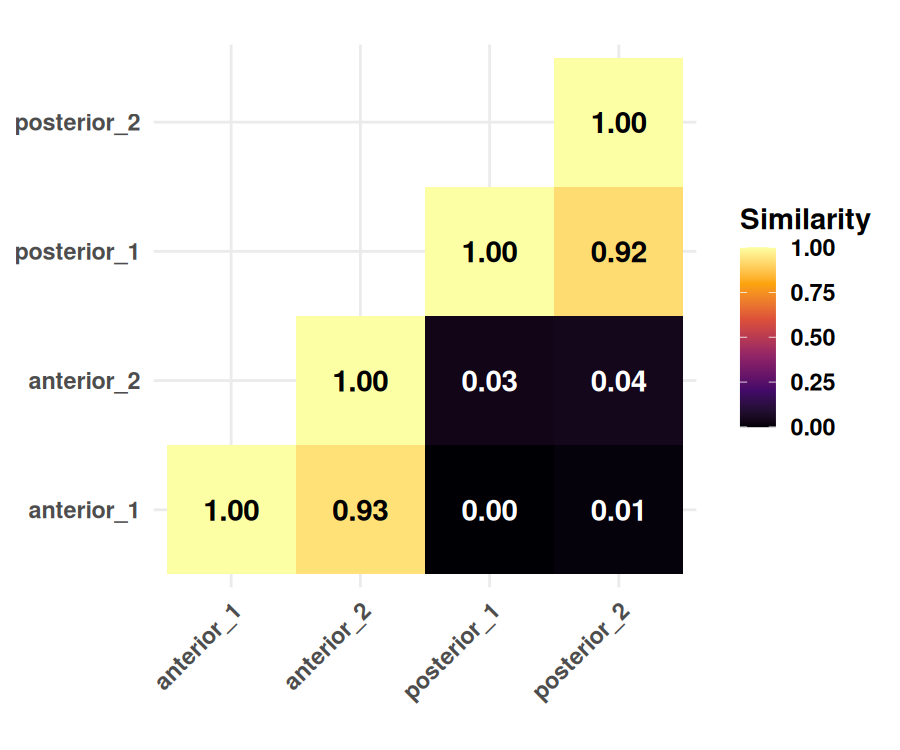

<!-- README.md is generated from README.Rmd with knitr::knit("README.Rmd"). Please edit that file -->


<p align="center">
  
</p>

Compute similarity between spatial transcriptomics samples based on which
labels (e.g. cell types) border one another.

## Installation

```r
remotes::install_github("george-hall-ucl/friendlyspots", subdir = "R")
```

Requires `dbscan` and `deldir`. Also available as a
[Python package](https://github.com/george-hall-ucl/friendlyspots/tree/main/python).

## Usage

Compatible with Visium, Visium HD (binned or segmented) and Xenium.

```r
library(friendlyspots)

# One data frame per sample, with columns x, y (positions, e.g. in pixels or
# micrometres) and label (see Extracting positions below)
samples <- list(sample_1 = df1, sample_2 = df2, sample_3 = df3)

sim <- spatial_similarity(samples)
```

Returns a sample × sample matrix with normalised similarity scores: 1 =
identical, 0 = least similar pair.

### Options

- `normalize = FALSE`: compare raw connection counts instead of proportions.
  This will make samples with different numbers of spots be considered
  spatially different even if their underlying spatial features are similar.
- `pools = list(group_1 = c("sample_1", "sample_2"), group_2 = "sample_3")`:
  sum connection counts within groups before comparing.
- `only_transitions = TRUE`: only count connections between spots with
  distinct labels (i.e. borders), not between spots with the same label.
- `neighborhood`: how to find each spot's or cell's neighbors. The default,
  `"auto"`, uses `"radius"` (all within `radius`) if the positions lie on a
  grid, and `"delaunay"` (the cells surrounding each cell) otherwise, with a
  message saying which. `"knn"` (the `k` nearest, default 6) is also available.
- `radius`: by default it's set from the spacing of the data, the median
  distance from each spot or cell to its nearest neighbor over all samples,
  times 1.2 for `"radius"` or 3 for `"delaunay"` (where it's the maximum link
  length). Give it, in the units of `x` and `y`, to widen or narrow
  neighborhoods.

### Extracting positions

For a Seurat object `obj` from `Load10X_Spatial()` (Visium; or Visium HD,
with e.g. `bin.size = 8` for bins or `bin.size = "polygons"` for segmented
cells) or `LoadXenium()` (Xenium), with cell types in `obj$cell_type`:

``` r
coords <- GetTissueCoordinates(obj)
df <- data.frame(x = coords$x, y = coords$y, label = obj$cell_type[coords$cell])
```

If an object holds several images, such as more than one bin size, choose one
with `image`, e.g. `GetTissueCoordinates(obj, image = "slice1.008um")`.

### Neighbors

With the defaults, each sample's spots or cells are linked to:

- Visium spots: their six immediate neighbors.
- Visium HD bins: their four side neighbors. Set `radius` to 1.5 times the bin
  size to add the diagonals.
- Segmented cells (Xenium, or Visium HD with cell segmentation): the cells
  surrounding them, ignoring links across gaps.

Positions can be the pixel or micrometre coordinates from Space Ranger or
Xenium outputs, as long as all samples use the same units. As the spacing is
taken over all samples, don't mix samples in different units, or from
different technologies.

### Example

Uses four mouse brain sections from 10x Genomics (two anterior, two posterior),
with each spot labelled by its most enriched of five marker genes.

<details><summary>Setup: download and label the data, define plotting helpers (click to expand)</summary>


``` r
# To rebuild this README from README.Rmd, run knitr::knit("README.Rmd")
# from the R/ directory (rmarkdown::render breaks the <details> block).
# Requires `Seurat`, `hdf5r` and `ggplot2`.
library(Seurat)
library(ggplot2)

markers <- c("Mbp", "Slc17a7", "Penk", "Hpca", "Gabra6")
ids <- c(anterior_1 = "V1_Mouse_Brain_Sagittal_Anterior",
         anterior_2 = "V1_Mouse_Brain_Sagittal_Anterior_Section_2",
         posterior_1 = "V1_Mouse_Brain_Sagittal_Posterior",
         posterior_2 = "V1_Mouse_Brain_Sagittal_Posterior_Section_2")
cache <- tools::R_user_dir("friendlyspots", "cache")

seurat_objects <- lapply(ids, function(id) {
  dir <- file.path(cache, id)
  if (!dir.exists(file.path(dir, "spatial"))) {
    url <- paste0("https://cf.10xgenomics.com/samples/spatial-exp/1.1.0/",
                  id, "/", id)
    dir.create(dir, recursive = TRUE, showWarnings = FALSE)
    download.file(paste0(url, "_filtered_feature_bc_matrix.h5"),
                  file.path(dir, "filtered_feature_bc_matrix.h5"))
    download.file(paste0(url, "_spatial.tar.gz"), tar <- tempfile())
    untar(tar, exdir = dir)
  }
  cells <- Load10X_Spatial(dir)
  counts <- as.matrix(GetAssayData(cells, layer = "counts")[markers, ])
  cells$cell_type <- markers[max.col(t(counts / rowMeans(counts)),
                                     ties.method = "first")]
  cells
})

plot_slices <- function(samples) {
  spots <- do.call(rbind, Map(cbind, sample = names(samples), samples))
  ggplot(spots, aes(.data$x, -.data$y, color = .data$label)) +
    geom_point(size = 1.1, stroke = 0) +
    facet_wrap(~sample, nrow = 1) +
    coord_fixed() +
    scale_color_manual(values = c("#CC79A7", "#D55E00", "#0072B2", "#F0E442",
                                  "#009E73")) +
    guides(color = guide_legend(override.aes = list(size = 4))) +
    theme_void(base_size = 14) +
    theme(legend.position = "bottom", legend.title = element_blank())
}

plot_similarity <- function(sim) {
  df <- as.data.frame(as.table(sim))
  lower <- df[as.integer(df$Var1) >= as.integer(df$Var2), ]
  ggplot(lower, aes(.data$Var1, .data$Var2, fill = .data$Freq)) +
    geom_tile() +
    geom_text(aes(label = sprintf("%.2f", .data$Freq),
                  color = .data$Freq < 0.1),
              size = 5, fontface = "bold", show.legend = FALSE) +
    scale_color_manual(values = c("black", "white")) +
    scale_fill_viridis_c(option = "inferno", name = "Similarity") +
    coord_fixed() +
    theme_minimal(base_size = 14) +
    theme(axis.title = element_blank(),
          axis.text.x = element_text(angle = 45, hjust = 1),
          text = element_text(face = "bold"))
}
```

</details>

Each sample is a data frame of spot positions (in full-resolution image
pixels) and labels:


``` r
library(friendlyspots)

samples <- lapply(seurat_objects, function(cells) {
  coords <- GetTissueCoordinates(cells)
  data.frame(x = coords$x, y = coords$y, label = cells$cell_type[coords$cell],
             row.names = coords$cell)
})
head(samples$anterior_1)
#>                       x    y   label
#> AAACAAGTATCTCCCA-1 8500 7474     Mbp
#> AAACACCAATAACTGC-1 2788 8552 Slc17a7
#> AAACAGAGCGACTCCT-1 7950 3163 Slc17a7
#> AAACAGCTTTCAGAAG-1 2100 6636     Mbp
#> AAACAGGGTCTATATT-1 2375 7115    Penk
#> AAACATGGTGAGAGGA-1 1480 8912 Slc17a7
```


``` r
plot_slices(samples)
```




``` r
sim <- spatial_similarity(samples)
#> Using neighborhood = "radius", as the positions lie on a grid.
round(sim, 2)
#>             anterior_1 anterior_2 posterior_1 posterior_2
#> anterior_1        1.00       0.93        0.00        0.01
#> anterior_2        0.93       1.00        0.03        0.04
#> posterior_1       0.00       0.03        1.00        0.92
#> posterior_2       0.01       0.04        0.92        1.00
plot_similarity(sim)
```



## Citation

The algorithm and original implementation of `friendlyspots` are based on the
methodology in:

- Durkin _et al_. "Functional integration of an autologous engineered esophagus
  in a large-animal model." _Nature Biotechnology_ (2026).
- Budinger _et al_. "An in vivo and in vitro spatiotemporal profile of human
  midbrain development." _Nature Communications_ (2026).

## Licence

Copyright (C) 2026 University College London. Licensed under GPL-3.0-or-later.

This program is free software: you can redistribute it and/or modify it under
the terms of the GNU General Public License as published by the Free Software
Foundation, either version 3 of the License, or (at your option) any later
version.

This program is distributed in the hope that it will be useful, but WITHOUT ANY
WARRANTY; without even the implied warranty of MERCHANTABILITY or FITNESS FOR A
PARTICULAR PURPOSE. See the GNU General Public License for more details.

You should have received a copy of the GNU General Public License along with
this program. If not, see http://www.gnu.org/licenses/.
