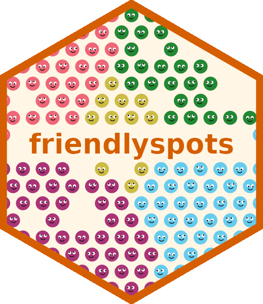

  

Compute similarity between spatial transcriptomics samples based on which
labels (e.g. cell types) border one another.

`friendlyspots` is only compatible with original (non-HD) Visium.

- R package: [`R/`](R/)
- Python package: [`python/`](python/)

Copyright (C) 2026 University College London. Licensed under GPL-3.0-or-later.
